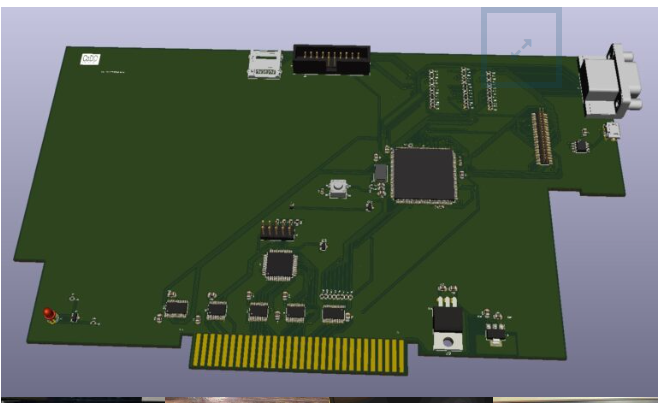
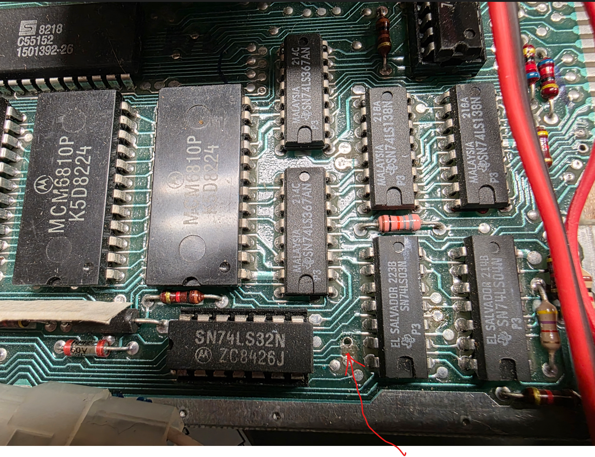
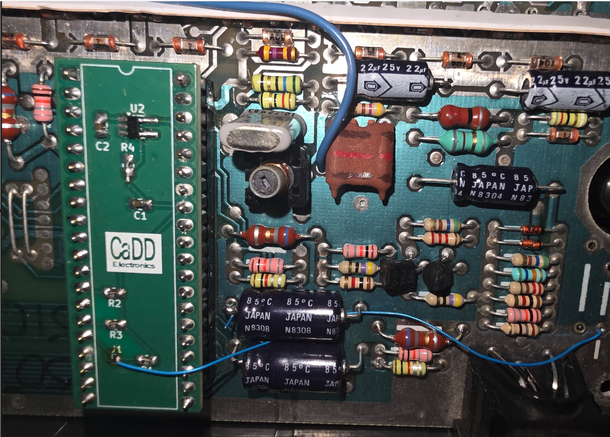
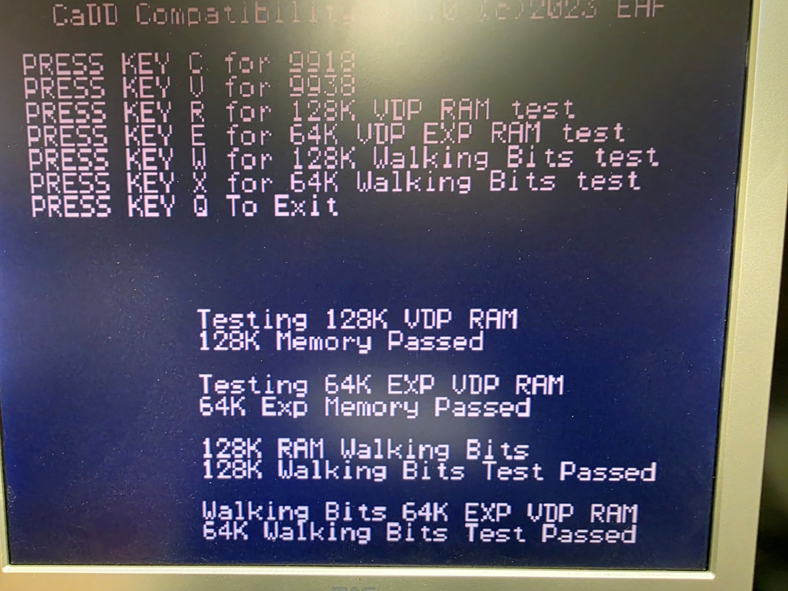
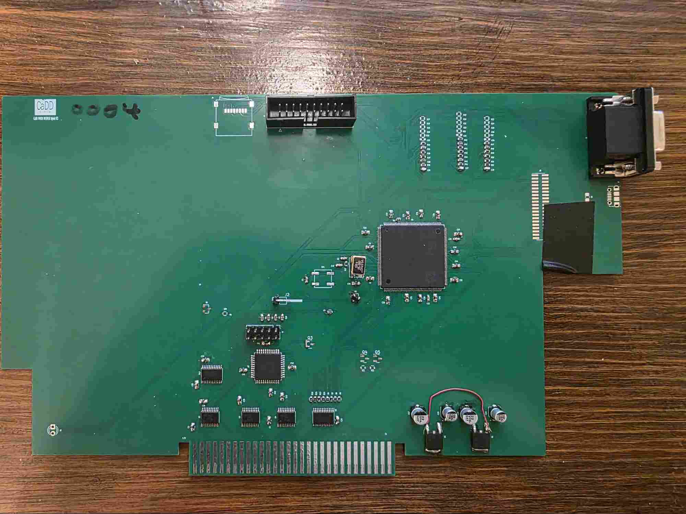
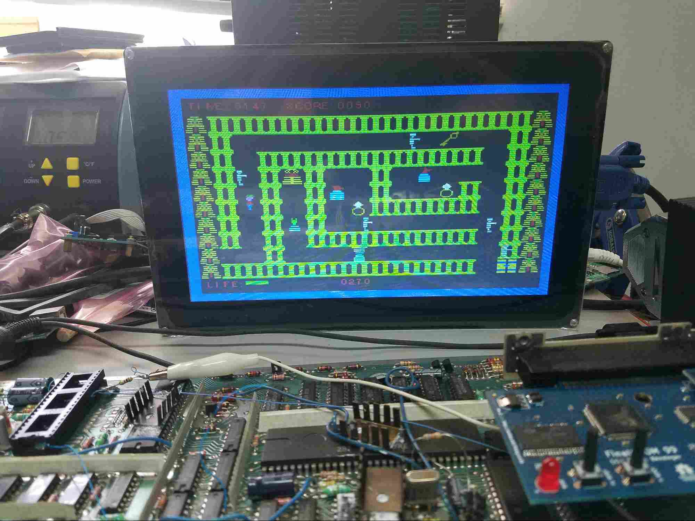
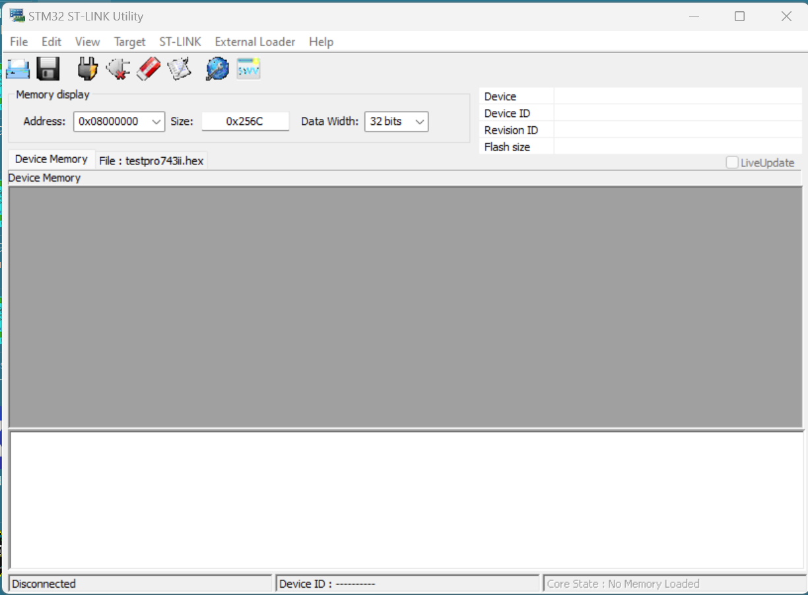
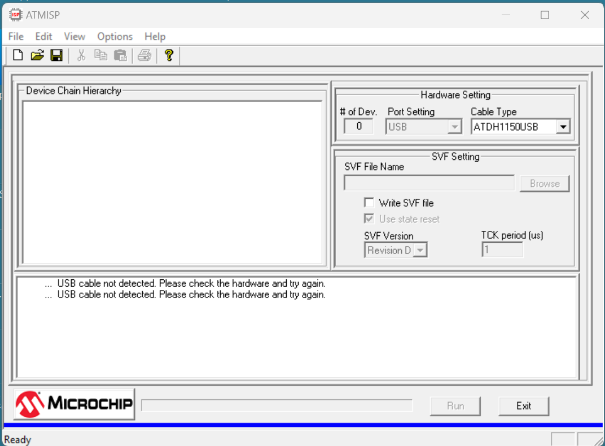

# CaDD Hybrid Video Card Manual

*CaDD Hybrid video card for the TI994A Peripheral Expansion Box.*

Transcribed from `CaDDHybridVideo-Manual.pdf`, downloaded from the SHIFT838
store product page for the CaDD V9938 Hybrid Video Card on 2026-10-24.

Product page: <https://www.shift838.com/store/index.php?rt=product/product&path=19_1_7&product_id=54>

The eight images embedded in the manual have been extracted to the adjacent
`images/` directory and are referenced in place below.



*Figure 1 - CaDD V9938 Hybrid Video card render.*

## Table Of Contents

- [Introduction](#introduction)
- [Shift 838](#shift-838)
- [Static Electricity](#static-electricity)
- [Installation](#installation)
- [GROM Clock Board](#grom-clock-board)
- [Usage](#usage)
- [Disclaimer](#disclaimer)
- [Test Software](#test-software)
- [Specifications](#specifications)
- [Acronyms](#acronyms)
- [Prototype 4](#prototype-4)
- [Updating code on the MCU](#updating-code-on-the-mcu)
- [Notes](#notes)
- [Q/A](#qa)
- [Warranty](#warranty)

## Introduction

Introducing the CaDD PEB video card. The card was designed to replace the
TMS9918A VDP chip with a more modern video processor. Originally the design was
going to do a full implementation of the V9938 without having to supply a DSR
to enable compatibility with the TMS9918A. To accomplish this, the card
implements the graphics and bitmap mode like the 9918 still allowing access to
the 192K RAM. This theoretically breaks software designed for the V9938 GR1 and
GR2, but since no software seems to be available for the TI in these modes it
seemed like the correct choice as the goal was to make the card seamlessly work
with all TI99/4A software.

The card was introduced at the Chicago faire several years ago with some
interest. The card originally had to compete against the F18A, since we had been
working on our implementation of the F18A for PC99W it was decided to add it to
the video card. Since many new games are being developed for the F18A it was the
only logical choice. Since the code base for PC99W is identical to the CaDD
video card any updates to PC99W are easily added to the video card.

On the original card we used an STM32F746. This is fine for only implementing
the V9938, that has full hardware acceleration for GR4–GR7 plus vertical scroll,
but it was not fast enough for the F18A having a GPU, and 2 tile layers with
vertical and horizontal scroll. It was decided to change the chip to a faster
STM32H743 in the same package. A simple port of the code and the new hybrid VDP
is up and running.

Many have asked why not make the video upgrade for the console. First the V9938
uses an extra address line, leading to the end user having to solder a wire.
Second the RAM is external to the processor requiring a larger board. Third the
micro uses a full 16 BPP buffer for the video; it is used for double buffering
the TI video via a U/V scalar that scales the video from (512 256) x (192 212
230) to 640x480. Even removing the CPLD, and buffers the board still requires a
fair amount of real estate. And lastly the hole in the console for the VGA
connector.

Using the PEB allows for only one via to be drilled on the console, and a single
wire from the console for the video interrupt. A special board was created that
has the GROM clock, and a header for the interrupt cleaning up the installation.
The single interrupt wire can be run out of any hole in the console, requiring
no cutting.

## Shift 838

The decision to have Chris Schneider AKA(Shift838) was easy. After purchasing
several PEB boards from Chris it was clear that Chris could build a high quality
product in larger quantities than CaDD, also allowing CaDD to work on other TI
projects. Additionally Chris does full function test on all products, when it
arrives you know it works.

## Static Electricity

Static Electricity precautions are required during installation of the video
card to prevent damage not only to the video card but to your entire TI setup.

- Find a metallic preferably grounded object to discharge static. Touching the
  object will cause static to discharge to a safe level for handling the board.
- Never touch the edge connector fingers.
- Never touch any of the components on the board.
- Handle the board from the upper right, and left sides.

## Installation

### Disassembling the console

Tools required:

- `#1` Philips screwdriver
- Drill bit
- Flat blade screwdriver

Safety: There are many sharp surfaces on PCB's, and shields. Be careful removing
all parts.

Remove all cords connected to the console, next remove all the Philips screws
from bottom cover, and gently remove the outer power switch. Slight uniform
pressure under each side will break it free. Remove the bottom cover, and all
Philips screws that are holding the power supply, main board, and keyboard.
Next support all three boards and turn the cover top side up. Next remove the
cover, keyboard connector, and power supply connector. Remove the shield from
the main board, locate, and remove the TMS9918A, replace it with the CaDD GROM
clock board, and drill the indicated via in pictorial. Locate and check
continuity of the via from top to bottom of the board, verifying it is an open
connection. (Optional for experienced technicians) Remove all VDP RAM chips,
they can be used on other stock consoles without VDP mod. Connect a wire from
the header on the GROM board, and run it out anywhere you like on the console.
You can remove the heat sink that was covering the VDP. Do not remove the
smaller heat sink on the clock chip.

Replace the shield, and reverse the process to re-assemble. Take care not to
pinch any wires. Also re-align all connectors so the pins are connected to the
correct ones. Do not force anything together it will go together easily once
all parts are aligned.

Lastly with PEB, and console unplugged from any power source connect the
interrupt wire to the header on the video card. Next install the video card
into an unused slot on the Peripheral Expansion Box. Align, and apply equal
force to the top corners of the board until it seats all the way in the PEB
edge connector. Replace the lid on the PEB, and insert the VGA connector in the
15 pin socket. Be sure not to rock the video card to keep in fully inserted
into the edge connector.

Drill this VIA.



*Figure 2 - Location of the via to drill on the console mainboard.*

## GROM Clock Board

The GROM clock board is meant to replace the VDP. J1 is the VDP interrupt
signal that gets connected to the video cards interrupt header. Since this
console has no VDP RAM chips installed the VDP interrupt was wired to where the
12V output for the RF modulator would have been supplied. This can only be done
if the surrounding components are removed making sure there is no connection to
anything else. The intended option is to run the wire through any hole in the
console, and connect it to the video card. Only those persons experienced in
electrical design should explore other options.



*Figure 3 - CaDD GROM clock board installed in the console VDP socket, with the
interrupt wire attached.*

## Usage

Power the PEB first followed by the console, the TI title screen should appear
on the VGA monitor. If you have a Final GROM you have instant access to many TI
software programs. To run software for the V9938 or F18A just launch it, no
other steps are necessary.

If you run an F18A program you cannot run a V9938 program without a hardware
reset. Power down the console first followed by the PEB. Power the PEB first
followed by the Console then launch V9938 software. If you are in V9938 mode and
the software was written to do a soft boot you can run subsequent V9938
programs without a hardware reset.

There are a couple of TMS9918 games that use automatic wrapping of VDP memory.
Run the CaDD hybrid software and select 9918 compatibility; this will cause the
VDP to automatically wrap at `0x4000`. Select V9938 to switch back.

Once in F18A mode the CaDD Hybrid software has no effect until hardware reset.

## Disclaimer

CaDD makes no Guarantee that the modes implemented on the card will function
identically to that of the F18A, 9918, or V9938.

## Test Software

This program is included to test the video card. It allows the user to test all
192K of RAM, as well as tailor the cards behavior for compatibility with a few
games. One game that requires it is MASH, as the helicopters are not shown
because the memory on the V9938 does not wrap at `0x4000`.



*Figure 4 - CaDD compatibility/configuration and VDP RAM test screen.*

## Specifications

### V9938

- Text
- Text 80
- Graphic 1
- Graphic 2 (also called bitmap mode)
- GR3
- GR4: 4 bits per pixel
- GR5: 2 bits per pixel, 512x(192 212)
- GR6: 4 bits per pixel, 512x(192 212)
- GR7: 8 bits per pixel, 256x(192 212)
- Interleave fully implemented doubling vertical resolution
- Vertical Scroll
- 192K VDP RAM

### F18A

- Tile layers 1, and 2
- Bitmap mode
- Text 80
- GR1 GR2
- Vertical and horizontal scroll
- 16K VDP RAM
- 64K GPU RAM
- GPU

## Acronyms

| Acronym | Meaning |
| --- | --- |
| VDP | Video Display Processor |
| PEB | Peripheral Expansion Box |
| GROM | Graphics Read Only Memory |
| RAM | Random Access Memory |
| ROM | Read Only Memory |
| GPU | Graphics Processing Unit (TMS 9900 with some modified instructions) |
| GRAM | Graphics Random Access Memory (Writeable GROM) |
| G RAM | Graphics RAM referred to in F18A documentation |
| JEDEC | Joint Electron Device Engineering Council |
| HEX | Hexadecimal |
| BLIT | Binary Bit Block Transfer |
| VGA | Video Graphic Array |



*Figure 5 - Assembled CaDD Hybrid Video card.*

## Prototype 4



*Figure 6 - Prototype 4 hardware running a game on a VGA monitor.*

Early Development, all text uses font blitting, and the rest of the screen has
two 8x8 bitmaps that are moved to multiple locations by the V9938 hardware
acceleration (The V9938 GPU). The mode is GR4 that is 4 bits per pixel (ONE
BYTE HOLDS 2 PIXELS DATA), every pixel can be one of 16 colors in this mode.

## Updating code on the MCU

The code is supplied as an Intel hex file. The Utility STLink is used to flash
the MCU. Using the installer, install the STLink software, this installs the
driver too.

With the PEB and console off connect the STLink to the video card. Next plug
the STLink into an available USB jack.

Launch the STLink utility select the micro, load the HEX record file.



*Figure 7 - STM32 ST-LINK Utility used to program the MCU.*

Power the PEB, and select connect. The tool will automatically determine the
device after it successfully connects to target.

Select program and verify.

Once programming has completed power down the PEB, remove the USB connector then
the STLINK dongle from the video card. Power on the PEB followed by the console,
the TI splash screen should appear.

For the CPLD the tool is Atmel ISP, and their JTAG dongle. Load the chain file
for programming, and run it. Next load the verify chain, and run it. That's it,
and remembers the dongles are not hot pluggable. You can have both dongles
plugged in at the same time.



*Figure 8 - ATMISP utility used for CPLD programming.*

Note: CaDD does not distribute the CPLD JEDEC file. Theoretically this will
never change.

## Notes

Bugs can be reported and when fixed a new downloadable hex record will be
available.

The CaDD VGA output is 565 RGB that equates to 65535 colors or 32 levels or
Red, and Blue, and 64 levels of Green. The 12 bit internal pallets of the
various VDP's limit this to 4096 colors. This equates to 16 levels of RGB.

## Q/A

### What is accelerated font blitting?

Just like line, or rectangles can be drawn using the GPU, CaDD added a new
accelerated function to the 9938 GPU. Like tile graphics where the characters
are represented by assigning a bitmapped font to each tile, and placing its
character number in the screen image table, and the VDP displays that tile at
the location implied by the ascending order of the memory location. The font
blitter allows you to specify an ASCII char, with a color and x/y location,
when commanded the ASCII char will appear on the screen in the active page. The
code sample is for demonstration in old style C, as this could be optimized to
be very efficient.

```c
BLTStr(x,y,str,len) //Blit string
int x,y;
char *str;
int len;
{
int i;
        RectGF(x,y,x+32,y+8,0x01); //Fill backgraound

        for(i = 0; i < len; i ++)
        {
            FontGF(x,y,0x09,str[i]); x = x + 6;
        }
}
```

```c
FontGF(x0,y0,col,asc) Accelerated font
int x0,y0,col;
char asc;
{
int w;
int h;

    VDPReg(36,x0);  //Set X
    VDPReg(37,0x00);
    VDPReg(38,y0);  //Set Y
    VDPReg(39,0x00);
    VDPReg(44,col);  //Set color
    VDPReg(45,asc); //Set ASCII char
    VDPReg(46,0x20); // Set command
    VDPReg(45,0x00); // Execute it

    WAITCO(); //wait for command to finish
}
```

### V9938 VS F18A GPU

Both devices have a GPU, they are different because in the case of the hybrid
card V9938 the GPU is an ARM core, and all commands that are given through
registers are executed via the ARM GPU, essentially just running code on the
MCU, as this is only a GPU because it is coded to be one. The hybrid F18A GPU
uses VDP memory accessible (`0x0000`-`0x3FFF`) and not accessible by the VDP
(`>0x3FFF`-`0x7FFF`). The core is a TMS9900 that has been modified for the GPU,
and a TMS9900 assembler can assemble code for it. It also yields itself well to
other high level languages like C.

### Why not HDMI?

First of all HDMI adds expense to the design, and VGA is adaptable to HDMI with
a low cost converter. Additionally it is doubtful that there would be a visible
difference.

### What VDP is the best choice?

While the 9938 has high speed graphics acceleration, and does not require the
programmer to have to write GPU code. The F18A does require the programmer to
write TMS9900 assembly language code to take full advantage of the card, and
other than DMA, and a PIX instruction, the programmer would have to write their
own graphics primitives code to accomplish what the V9938 has by default. On
the other side having part of your program running in the GPU has serious
advantages.

### V9938 scroll vs F18A

The F18A has a superior scroll to the V9938 having 4 pages because you can move
between the pages by simply setting the scroll registers. Additionally the
V9958 had vertical and horizontal scroll but it was limited the active page.

### Why is there a CPLD on the video card?

The card is memory mapped to the same locations on the TI's VDP plus two more
addresses are required. The CPLD decodes the TI's address space and controls
some other handshaking. The address space can be changed to allow two video
cards to be used simultaneously.

## Warranty

CaDD warrantees this product to be free from defect for a period of 90 days
from the date of purchase or ship date. The warrantee does not cover damage
from hot plugging or static electricity, nor for physical damage. The warrantee
does cover premature component failure, and manufacturing defects. During the
warrantee period CaDD will repair or replace the card at our discretion,
meaning the card will be in new usable condition. In the event CaDD determines
the card is defective for reasons not caused by the customer CaDD will cover
all repair costs, except for transportation, of the card.
